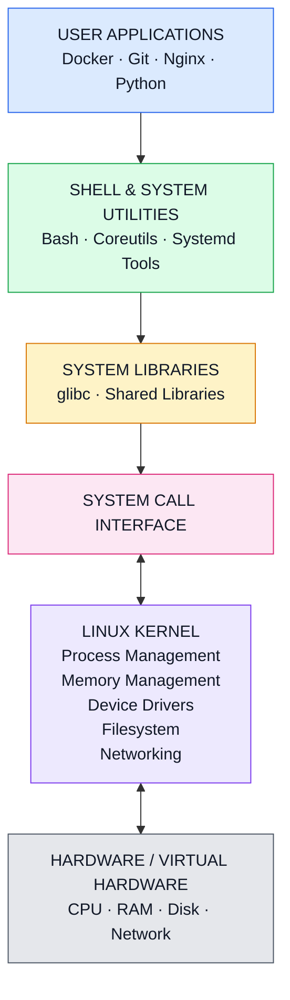
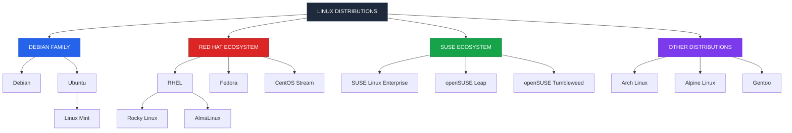
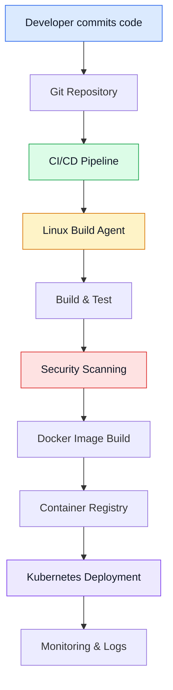

# 🐧 Linux Junction
### The Complete Linux Learning Journey | Beginner to Advanced

<p align="center">
  
  
  
  
</p>

<p align="center">
  <b>Learn Linux. Understand the Architecture. Master the Command Line. Automate Everything.</b>
</p>

---

## 📖 About This Repository

Welcome to **Linux Junction**, a comprehensive Linux learning repository designed to take you from absolute beginner to advanced Linux administration and DevOps engineering.

This repository provides structured learning materials, practical command examples, architecture diagrams, hands-on exercises, troubleshooting scenarios and real-world projects.

The learning approach follows the foundational subject areas covered by Linux education programs such as the **Linux Foundation's LFS101 – Introduction to Linux**, while extending into Linux administration, Bash scripting, security, networking and DevOps practices.

Whether you are starting your Linux journey or preparing for a DevOps, Cloud, System Administrator or Platform Engineering role, this repository will serve as your learning and reference guide.

### 🎯 Repository Objectives

- Understand Linux fundamentals, history and philosophy.
- Learn Linux architecture and how operating systems work.
- Understand different Linux distributions and their ecosystems.
- Develop strong command-line skills.
- Learn filesystem management, users, groups and permissions.
- Understand process, service and package management.
- Master Linux networking and troubleshooting.
- Develop Bash scripting and automation skills.
- Understand Linux security and system administration.
- Apply Linux knowledge to Docker, Kubernetes, CI/CD and DevOps.
- Practise real-world scenarios and technical interview questions.

---

## 🗺️ Complete Linux Learning Roadmap

The repository is divided into three major learning levels.

| Level | Learning Path | Focus |
|---|---|---|
| 🟢 Level 1 | Beginner | Linux Fundamentals |
| 🟡 Level 2 | Intermediate | Linux Administration |
| 🔴 Level 3 | Advanced | Advanced Linux & DevOps |

### 🟢 LEVEL 1 – BEGINNER

**Build strong Linux fundamentals from scratch.**

| Module | Topic | What You Will Learn |
|---|---|---|
| 00 | Getting Started | Linux environment, WSL and lab setup |
| 01 | Linux Fundamentals | History, philosophy, architecture and terminology |
| 02 | Linux Distributions | Ubuntu, Debian, Red Hat and SUSE families |
| 03 | Linux Installation | Ubuntu, WSL, installation and boot process |
| 04 | Linux Commands | Basic commands, navigation and file operations |
| 05 | Filesystem & Storage | Linux directory structure, filesystems and storage |
| 06 | Users, Groups & Permissions | User management, ownership, chmod and chown |

**Expected outcome:** Become comfortable with Linux fundamentals, terminal operations, filesystem navigation and basic Linux administration.

### 🟡 LEVEL 2 – INTERMEDIATE

**Learn to administer, manage and troubleshoot Linux systems.**

| Module | Topic | What You Will Learn |
|---|---|---|
| 07 | Process & Service Management | Processes, signals, systemd and services |
| 08 | Package Management | APT, DNF, RPM and Zypper |
| 09 | Linux Networking | IP, DNS, SSH, ports and network troubleshooting |
| 10 | Bash Scripting | Variables, loops, conditions and functions |
| 11 | System Administration | System configuration, scheduling and maintenance |
| 12 | Linux Security | SSH security, sudo, firewall and hardening |
| 13 | Logs & Troubleshooting | Log analysis, system diagnostics and debugging |

**Expected outcome:** Manage Linux systems independently, automate repetitive tasks and troubleshoot common operational problems.

### 🔴 LEVEL 3 – ADVANCED

**Develop production-level Linux and DevOps engineering skills.**

| Module | Topic | What You Will Learn |
|---|---|---|
| 14 | Advanced Linux | Kernel, performance, storage and system internals |
| 15 | Linux for DevOps | Docker, Kubernetes, CI/CD and automation |
| 16 | Interview Preparation | Technical questions and real-world scenarios |
| 17 | Practical Labs | Beginner, intermediate and advanced exercises |
| 18 | Real-World Projects | Linux automation and production-style projects |

**Expected outcome:** Apply Linux knowledge to real-world infrastructure, automation, containerisation, security and DevOps workflows.

---

## 🏗️ Linux Operating System Architecture

Understanding Linux architecture is essential before moving into system administration and troubleshooting.

Linux consists of multiple components that work together to provide a complete operating environment.

### High-Level Linux Architecture



### Major Architecture Components

| Component | Description |
|---|---|
| Hardware | Physical or virtual CPU, RAM, storage and network devices |
| Kernel | Core of Linux that manages hardware and system resources |
| System Call Interface | Allows user-space programs to request kernel services |
| System Libraries | Provide reusable interfaces for applications |
| Shell | Interprets commands and starts programs |
| System Utilities | Provide essential operating-system functionality |
| Applications | Software such as Docker, Git, Nginx and Python |

**Important:** Linux is technically a kernel. A complete Linux distribution combines the kernel with user-space utilities, libraries, package management and applications.

---

## 🌍 Linux Distribution Family Tree

Linux distributions are complete operating-system environments built around the Linux kernel.

Different distributions provide different package managers, release models, support lifecycles and system administration tools.

### Linux Distribution Architecture



### Distribution Comparison

| Distribution Family | Examples | Package Format | Package Manager |
|---|---|---|---|
| Debian | Debian, Ubuntu | DEB | APT |
| Red Hat | RHEL, Fedora, Rocky Linux | RPM | DNF |
| SUSE | SLES, openSUSE | RPM | Zypper |
| Arch | Arch Linux | PKG | Pacman |
| Alpine | Alpine Linux | APK | apk |

### Common Package Management Commands

**Ubuntu / Debian**

```bash
sudo apt update
sudo apt upgrade
sudo apt install nginx
sudo apt remove nginx
```

**Red Hat / Fedora**

```bash
sudo dnf check-update
sudo dnf upgrade
sudo dnf install nginx
sudo dnf remove nginx
```

**SUSE**

```bash
sudo zypper refresh
sudo zypper update
sudo zypper install nginx
sudo zypper remove nginx
```

---

## 💻 Practical Learning Environment

This repository is designed around hands-on Linux practice.

### Recommended Lab Environment

| Environment | Purpose |
|---|---|
| Ubuntu on WSL | Primary Linux learning environment |
| Ubuntu Virtual Machine | Linux system administration |
| Debian VM | Distribution comparison |
| Rocky Linux / AlmaLinux VM | Red Hat ecosystem practice |
| Docker | Container and Linux kernel concepts |
| Kubernetes | Container orchestration and troubleshooting |

### Verify Your Linux Environment

```bash
whoami
hostname
cat /etc/os-release
uname -a
pwd
```

### Create Your Linux Practice Directory

```bash
mkdir -p ~/linux-lab/{files,logs,scripts,backup}
```

---

## 🧪 Hands-On Practical Labs

Every learning level includes practical exercises.

### Beginner Labs

- Linux system information
- Directory navigation
- File and directory creation
- File copying, moving and deleting
- Reading and writing files
- Linux permissions
- File searching
- System resource monitoring
- Process management
- Basic troubleshooting

### Intermediate Labs

- User and group administration
- Service management
- Package installation
- Network configuration
- SSH connectivity
- Log analysis
- Bash scripting
- Cron job automation
- System troubleshooting

### Advanced Labs

- Linux performance analysis
- Storage and filesystem administration
- Advanced Bash automation
- Linux security hardening
- Service failure investigation
- Container troubleshooting
- Linux-based CI/CD automation

---

## 🛠️ Linux Commands Cheat Sheet

Some of the most frequently used Linux commands:

| Category | Commands |
|---|---|
| Navigation | `pwd`, `ls`, `cd`, `tree` |
| File Management | `touch`, `mkdir`, `cp`, `mv`, `rm` |
| File Viewing | `cat`, `less`, `head`, `tail` |
| Text Processing | `grep`, `awk`, `sed`, `cut`, `sort` |
| Permissions | `chmod`, `chown`, `chgrp`, `umask` |
| Users & Groups | `useradd`, `usermod`, `passwd`, `id` |
| Process Management | `ps`, `top`, `htop`, `kill`, `pgrep` |
| Networking | `ip`, `ping`, `curl`, `ss`, `ssh` |
| Storage | `df`, `du`, `lsblk`, `mount` |
| Services | `systemctl`, `journalctl` |
| Package Management | `apt`, `dnf`, `zypper` |
| System Information | `uname`, `hostname`, `uptime`, `free` |

---

## 🚀 Why Linux Is Important for DevOps Engineers

Linux is a foundational technology across modern DevOps and cloud infrastructure.

| DevOps Area | Linux Application |
|---|---|
| CI/CD | Running build and deployment agents |
| Docker | Container runtime and kernel isolation |
| Kubernetes | Worker nodes and container workloads |
| Cloud | Linux virtual machines and cloud infrastructure |
| Automation | Bash and configuration management |
| Monitoring | System metrics and log collection |
| Security | Access control, patching and hardening |
| DevSecOps | Security scanning and infrastructure protection |

### Linux in a DevOps Workflow



---

## 📚 Learning Resources

### Official Documentation

| Resource | Link |
|---|---|
| The Linux Foundation | https://www.linuxfoundation.org/ |
| LFS101 – Introduction to Linux | https://training.linuxfoundation.org/training/introduction-to-linux/ |
| Linux Kernel Documentation | https://docs.kernel.org/ |
| Ubuntu Documentation | https://help.ubuntu.com/ |
| Debian Documentation | https://www.debian.org/doc/ |
| Red Hat Documentation | https://docs.redhat.com/ |
| SUSE Documentation | https://documentation.suse.com/ |
| GNU Bash Manual | https://www.gnu.org/software/bash/manual/ |

### Additional Learning

- Linux command-line practice
- Shell scripting exercises
- Linux administration labs
- Docker and Kubernetes documentation
- Open-source projects and community resources

---

## 🎯 Learning Strategy

Follow this learning sequence:

1. Understand the theory.
2. Study the architecture and workflow diagrams.
3. Practise the commands in Ubuntu.
4. Complete the hands-on exercises.
5. Solve troubleshooting scenarios.
6. Prepare technical interview answers.
7. Document what you have learned.

**Do not just memorise commands. Understand what happens behind every command you execute.**

---

## 📈 Learning Progress

Track your learning journey through [ROADMAP.md](ROADMAP.md).

- [ ] Beginner Level – Linux Fundamentals
- [ ] Intermediate Level – Linux Administration
- [ ] Advanced Level – Linux & DevOps
- [ ] Practical Labs
- [ ] Real-World Projects

---

## 🤝 Contributions

This repository is maintained as a structured learning and knowledge-sharing resource.

Contributions, corrections, documentation improvements and practical examples are welcome.

Please refer to [CONTRIBUTING.md](CONTRIBUTING.md).

---

## ⚠️ Disclaimer

Linux Junction is an independent educational repository. It is not affiliated with, endorsed by or officially maintained by The Linux Foundation.

LFS101 is referenced as an educational inspiration. This repository does not reproduce official course materials or provide the LFS101 certification.

Always follow official documentation and use disposable lab environments for potentially destructive system administration exercises.

---

<p align="center">
  <b>Learn • Practise • Automate • Troubleshoot • Master Linux</b>
</p>

<p align="center">
  ⭐ If this repository helps you learn Linux, consider giving it a star!
</p>
